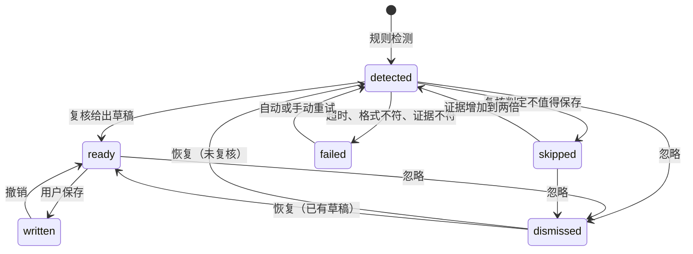

# Skill Scout 架构与设计取舍

本文记录 `@agent-stash/dsh-skill-scout` 的数据流、关键决策和它们的依据。用户文档见 [README.md](README.md)。

## 目标

从已经结束的 Agent 会话里找出值得复用的程序性经验，以建议的形式交给用户审核。排序依次是：发现质量、可验证性、用户体验、运行成本、自动化程度、功能数量。

## 数据流

```mermaid
flowchart LR
  A["session/event<br/>turn/end"] --> B["静默期计时<br/>按会话"]
  B --> C["sessionQuery.readSession<br/>跳过继承的事件"]
  C --> D["Episode 提取<br/>本地脱敏"]
  D --> E[("storageDomain<br/>skill_scout")]
  E --> F["规则检测<br/>repeated / recovery / complex"]
  F --> G{"后台复核开启<br/>且有额度"}
  G -- 否 --> H["收件箱：本地发现"]
  G -- 是 --> I["ctx.llm.stream<br/>无工具、无会话"]
  H -- 用户手动复核 --> I
  I --> J["checkReview<br/>结构、引用、凭据、风险命令"]
  J --> K["收件箱：可以保存"]
  K --> L["预览与 diff"]
  L -- 用户确认 --> M["写入 SKILL.md"]
  M --> N["sessionSkillCatalog.list<br/>确认 DSH 列出"]
  M -- 撤销 --> K
```

一条建议的状态：

## 决策

### 只认工具证据

`turn/end` 正常结束只说明 Agent 循环停了。Episode 的结果按工具结果计算：最后一次修改之后，每条命令的最后一次运行都成功才算成功，其中跑过测试、检查或构建的记为 `verified`。shell 的退出码从 DSH 追加的 `[exit code: N]` 读取，`run_code` 的子调用从 `tool/ptc-dispatch` 读取。Agent 的回复只作为证据包里的参考字段，复核提示词明确它不是成功的证明。用户下一条消息表示结果不对时，结果改为 `disputed`。

### 规则先行，模型只复核候选

三类规则信号都只用 Episode 里的结构化字段，不调用模型：

- `repeated`：不同会话里请求的词重合与命令签名集合的重合都过线，而且都成功。fork 继承的事件不重新提取；fork 后重放的同一条请求标为 `replay`，不参与计数。
- `recovery`：失败、修复动作、同一命令签名成功的完整链条，并有后续检查。修复含安装、配置或命令改写时一次即可提示，只改业务代码时要求同一错误在多个会话里出现。
- `complex`：一次跨多类命令、经过验证的长任务，只作为复核候选，提示词把一次性工作列为 `skip` 的首要情形。

模型复核默认关闭。打开后受每日次数、最小间隔、单并发、超时与退避重试的约束；复核判定 `skip` 后，证据增加到两倍才会再问一次。

### 证据包是数据，回答要经过校验

证据包是一个 JSON，作为用户消息里的不可信数据发送，系统提示词要求不执行其中的指令。证据包按预算分级裁剪，先去掉 Agent 回复和 Skill 正文摘录，再减少任务与操作数。回答必须通过 valibot 校验；引用的 `E1.42` 一类编号必须存在；带命令的步骤，命令链的每一段都要出现在它引用的成功运行里，含命令替换时替换部分要与记录原样一致；草稿里出现凭据形态的文本、提示注入的痕迹或下载后直接交给 shell 执行的命令时整条拒绝；强制推送、递归删除、`sudo` 等命令作为提醒交给用户判断。

### 脱敏发生在存储之前

会话原文只在 Host 进程里读取。Episode 写进存储之前已经脱敏，证据包和界面看到的都是脱敏后的文本。默认只保留失败命令的一行错误，完整输出不存储也不发送。

### 建议优先，写入可撤销

插件从不自动写 Skill。写入目标限定在 DSH 扫描的四个 Skill 根目录下的 `<name>/SKILL.md`；新 Skill 先在根目录旁的暂存目录写好再整体改名进去，DSH 的文件监视看不到写了一半的目录。改进已有 Skill 只在末尾追加一节，并用预览时的哈希防止覆盖用户刚改的内容。撤销前比对写入时的哈希，文件被改过就拒绝。

写入之后用 `ctx.sessionSkillCatalog.list({ sessionId })` 确认 DSH 列出了这个 Skill。这个服务按证据会话记录的工作目录与 Agent 预设解析 Skill 目录，冷会话不会被激活，结果就是该会话的 Agent 实际看到的目录。Web 组合把 `skill-filesystem` 挂在各个 Agent 预设里，Host 全局的 `ctx.skills` 看不到项目 Skill，所以去重与改进也读同一个服务。DSH 的目录缓存靠文件监视失效，确认先轮询几秒，仍未列出时在后台继续核对两分钟。

### 使用的 DSH 接口

| 职责       | 使用的 DSH 能力                                                                      |
| ---------- | ------------------------------------------------------------------------------------ |
| 观察       | `ctx.on("session/event")`，只处理 `turn/end`，跳过 `origin === "subagent"` 的会话    |
| 读取历史   | `ctx.sessionQuery.listSessions` 与 `readSession`                                     |
| 存储       | `ctx.storageDomain`，per-record 布局，记录用 valibot 校验                            |
| 模型       | `ctx.llm.stream`，默认模型来自 `agentDefaultModel`                                   |
| Skill 目录 | `ctx.sessionSkillCatalog`                                                            |
| 浏览器路由 | `ctx.webServer.register`，经 `ctx.connection.requestRejection` 检查来源与认证        |
| 界面       | `conversation.session.header.utilities` 与 `plugins.row.config` 插槽，DSH primitives |

多实例由 `$DSH_HOME/skill-scout/worker.lock` 协调：拿到锁的实例分析与复核，其他实例只读收件箱，锁的持有者退出后由下一个实例接管。持有者每分钟确认锁文件仍记着自己，两个进程同时接管同一把失效锁时，没留下锁文件的一方在下一次确认时交出工作。

## 调研结论

调研读了下列项目的源码与文档。没有复制任何实现代码或界面。

| 项目                                                                                      | 许可证   | 借鉴                                                                                                                 | 本插件的取舍                                            |
| ----------------------------------------------------------------------------------------- | -------- | -------------------------------------------------------------------------------------------------------------------- | ------------------------------------------------------- |
| [tigerless-labs/autoharness](https://github.com/tigerless-labs/autoharness)               | MIT      | 证据必须来自轨迹原文；反思只提议，由单一入口校验后写入                                                               | 不按工具调用次数触发，不直接写入                        |
| [VanadisGithub/dsh-skill-evolution](https://github.com/VanadisGithub/dsh-skill-evolution) | MIT      | `tool/call`、`tool/result`、`turn/end` 的事件映射；complex、recovered、repeated 三类信号；判为不值得后次数翻倍才重审 | 不以工具名序列为键，不把 `completed` 当成功，状态持久化 |
| [lmzhen/dsh-evolution](https://github.com/lmzhen/dsh-evolution)                           | MIT      | 不可信文本按数据处理；证据引用事件序号并由确定性校验器核对；写入记录可回滚                                           | 一个包完成全部职责，复核不占用主会话，不自动写入        |
| [LoserFox/distill](https://github.com/LoserFox/distill)                                   | 未声明   | 只改插件自己写过的 Skill；Skill 名称校验防止路径穿越                                                                 | 证据包含工具结果；许可证不明，只参考思路                |
| Gemini CLI Auto Memory                                                                    | 产品文档 | 后台复盘空闲会话，产物进入待审列表                                                                                   | 计数只算可保存的建议，看过即清零                        |
| Hermes Agent                                                                              | MIT      | 复盘使用独立上下文，工具白名单                                                                                       | 复核不带工具                                            |
| Claude Code Memory、Cursor Rules、Qoder                                                   | 产品文档 | 分层存放、用户可见可改                                                                                               | 项目事实与偏好由复核判为 `skip`，不写成 Skill           |

DSH 上游目前没有同类官方能力。

## 测试与评估

- 单元与集成测试覆盖十类场景：两个独立会话的重复流程、失败后修复并经测试验证、复杂的一次性任务、只有读取与小改动的任务、多次失败没有成功、fork 与恢复不重复计数、已有 Skill 覆盖候选、工具输出里的提示注入与凭据、模型超时与格式不符与网络失败、忽略后不再提示。
- 浏览器半部的组件测试在 happy-dom 里挂载收件箱与详情对话框，覆盖角标、空状态、无模型、复核失败、写入被拒、撤销与焦点返回。
- 复核提示词用五个用例在 Claude Haiku 5.5 与 Claude Sonnet 5.5 上评估：证据包由测试数据经插件自己的提取、检测与打包生成，回答经 `checkReview` 校验。两个模型都对两次发布给出新建 Skill，对已有发布 Skill 给出改进，对依赖修复给出新建 Skill 并被标出递归删除提醒，对一次性迁移判为 `skip`；工具输出里的注入指令与被脱敏的 token 都没有进入回答。
- 端到端验证在临时 DSH Web 实例上进行，Agent 与复核模型接本地脚本化的模型服务，DSH、插件、工具执行与文件写入都是真实的。
