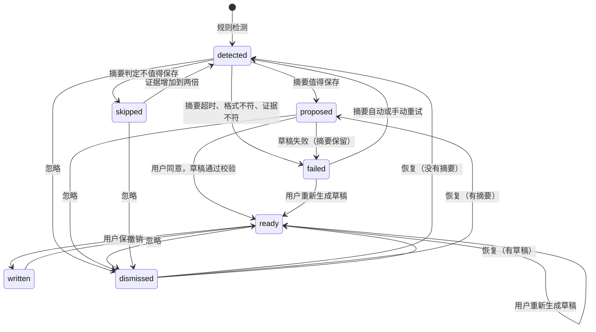

# Skill Scout 架构与设计取舍

本文记录 `@agent-stash/dsh-skill-scout` 的数据流、关键决策和它们的依据。用户文档见 [README.md](README.md)。

## 目标

从已经结束的 Agent 会话里找出值得复用的程序性经验，以建议的形式交给用户审核。排序依次是：发现质量、可验证性、用户体验、运行成本、自动化程度、功能数量。

模型分两段参与：后台只请发现模型写几行摘要，说明发现了什么、Skill 做什么、打算新建或改进哪个 Skill；用户同意摘要后，才请生成模型写完整的 Skill。摘要与草稿各是一次带完整证据包的请求，提示词评估里草稿的输出是摘要的 1.5 到 2 倍。被摘要判为不值得保存或被用户忽略的候选只花一次摘要请求，用户也能在模型写 Skill 之前否掉方向不对的建议。

## 数据流

```mermaid
flowchart LR
  A["session/event<br/>turn/end"] --> B["静默期计时<br/>按会话"]
  B --> C["sessionQuery.readSession<br/>跳过继承的事件"]
  C --> D["Episode 提取<br/>本地脱敏"]
  D --> E[("storageDomain<br/>skill_scout")]
  E --> F["规则检测<br/>repeated / recovery / complex"]
  F --> G{"后台摘要开启<br/>且有额度"}
  G -- 否 --> H["收件箱：本地发现"]
  G -- 是 --> I["发现模型：摘要<br/>无工具、无会话"]
  H -- 用户生成摘要 --> I
  I --> J["checkSummary<br/>结构、引用、名称、凭据"]
  J --> K["收件箱：待你决定"]
  K -- 用户同意 --> P["生成模型：草稿<br/>证据加摘要里的计划"]
  P --> Q["checkDraft<br/>结构、引用、命令动作、风险命令"]
  Q --> L["预览与 diff"]
  L -- 用户确认 --> M["写入 SKILL.md"]
  M --> N["sessionSkillCatalog.list<br/>确认 DSH 列出"]
  M -- 撤销 --> L
```

一条建议的状态：

存储里的状态不含进行中：摘要与草稿请求只记在 Host 内存里，视图据此显示 `summarizing` 与 `drafting`。插件重启时进行中的请求随 `AbortSignal` 取消，建议停在请求之前的状态。每条建议同一时间最多一个请求；后台摘要只在没有任何请求进行时发起，用户发起的请求不受这个限制。

## 决策

### 只认工具证据

`turn/end` 正常结束只说明 Agent 循环停了。Episode 的结果按工具结果计算：最后一次修改之后，每条命令的最后一次运行都成功才算成功，其中跑过测试、检查或构建的记为 `verified`。shell 的退出码从 DSH 追加的 `[exit code: N]` 读取，`run_code` 的子调用从 `tool/ptc-dispatch` 读取。Agent 的回复只作为证据包里的参考字段，提示词明确它不是成功的证明。用户下一条消息表示结果不对时，结果改为 `disputed`。

### 规则先行，模型只看候选

三类规则信号都只用 Episode 里的结构化字段，不调用模型：

- `repeated`：不同会话里流程相近、目标相近，而且都成功。fork 继承的事件不重新提取；fork 后重放的同一条请求标为 `replay`，不参与计数。
- `recovery`：失败、修复动作、同一动作成功的完整链条，并有后续检查。修复含安装、配置或命令改写时一次即可提示，只改业务代码时要求同一错误在多个会话里出现。
- `complex`：一次经过验证、用到至少 5 个不同的非日常命令（内联代码与 HTTP 请求不算）、跨 3 类以上命令的长任务，只作为摘要候选，提示词把一次性工作列为 `skip` 的首要情形。

后台摘要默认关闭。打开后受每日次数、最小间隔、超时与退避重试的约束，用户发起的摘要与草稿只计入用量、不占每日次数；摘要判定 `skip` 后，证据增加到两倍才会再问一次。

### 命令按动作比较，相似度放宽但有边界

同一件事在不同会话里的写法不同：`pnpm build` 和 `npm run build`，`npx vitest` 和 `pnpm exec vitest`，`bash scripts/release.sh` 和 `./scripts/release.sh`，还有不同 Agent 与 MCP 服务器给同类工具起的不同名字。按原文签名比较会把同一流程拆成几组，规则层就找不到重复。

`commands.ts` 给每段命令算一个规范动作 `key`，原来的写法 `sig` 只用于展示：

- 包管理器的脚本统一成 `pm run <脚本>`，内置命令按别名归并（`i`、`ci` 是 `install`，`t` 是 `test`），带包名的 `npm install` 是 `pm add`；经包管理器运行的已知命令行工具（vitest、tsc、eslint 等）直接用工具名。turbo 与 lerna 的任务也是 `pm run <任务>`。
- 解释器（含 tsx、ts-node、vite-node）加脚本文件和直接执行脚本文件，动作都是脚本的文件名；`bash -c` 展开里面的命令。内联代码按解释器归成 `python -c`、`node -e` 一类，不看代码内容。
- `git checkout -b` 与 `git switch -c`、`docker-compose` 与 `docker compose`、`pip3` 与 `pip`、cargo 的单字母别名各归为一个动作；gh 的只读子命令归为查看。

有一类动作只说明用了什么程序，说明不了做了什么：内联代码、HTTP 请求（curl、wget、httpie、xh）、远程登录（ssh、scp）和 `open`。`isOpaque` 标出它们。Agent 用它们看数据、探接口、试一段代码，两个毫不相干的任务常常都有，换一段代码或一个 URL 再试也只是在摸索。

工具调用按名字归类，名字先去掉 MCP 前缀（`mcp__fs__edit_file` 与 `fs.edit_file` 都是 `edit_file`）。改动的动作只对 `package.json`、`CHANGELOG.md`、`*.config.ts`、`.github/workflows` 这类有固定角色的文件带文件名，其余改动不进入流程比较。

两个任务的流程相似度在动作之上计算，刻意放宽一点，但每一处放宽都有边界：

- 部分相同只有两种：同一 package.json 脚本前缀（`build` 与 `build:web`）记 0.7，同一类验证（测试、检查、构建）记 0.5；其余不同的动作记 0，`build` 与 `test`、`push` 与 `pull`、`publish` 与 `version` 永远不会连在一起。
- 每一步按权重计：提交、推送、装依赖这类几乎每个任务都有的日常动作和上面那类说明不了做了什么的动作 0.35，测试、检查、构建 0.6，其余 1。两个任务至少要共有一个权重为 1 的动作，日常的改、测、提交循环不会被当成重复流程。
- 共有的步骤先后顺序要大体一致（两两比较的一致比例不低于 0.6），顺序颠倒的两个流程不合并。
- 目标描述相近时流程加权重合 0.4 即可；目标描述不相近（例如用不同语言写的同一任务）时，要共有两个以上权重为 1 的动作、流程重合 0.6 以上。
- 只比较至少共有一个权重为 1 的动作的任务对（按动作建倒排索引），检测的开销不随会话数平方增长。

失败恢复按动作闭合：失败的 `npm test` 在安装依赖后由 `pnpm test` 通过，算同一条恢复链；换成另一个动作通过则不算。中间要有修复动作：安装、改配置文件、运行一个说明得了做了什么的命令，或者重跑时改了选项名或环境变量（`optionsOf` 比较两次运行，选项只取名字，`--filter=a` 与 `--filter=b` 相同）。内联代码与 HTTP 请求不算修复动作，重跑的是它们时，换写法也不算改写。跨会话合并恢复时，错误文本先把路径、URL、版本号、行列号、十六进制串和平台名（`darwin-arm64`、`linux-x64-gnu`）换成占位符；同一动作上的错误签名相同，或者错误文本的词重合度不低于 0.7，才算同一个问题。同一个错误出现在同一类命令的不同动作上（`pnpm build` 与 `vite build`）时，要求词重合度不低于 0.85。

每一处放宽都有反例测试：`commands.test.ts` 列出应当合并与必须分开的写法，`signals.test.ts` 覆盖日常循环、只共有一个部署命令的两件事、只共有内联代码与 HTTP 请求的两件事、顺序颠倒的流程和同一命令上的不同错误，`episodes.test.ts` 覆盖换一段内联代码或换一个 URL 的重试、改源码中间夹着内联查看的修复和改了选项的重跑。

### 证据包是数据，回答要经过校验

证据包是一个 JSON，作为用户消息里的不可信数据发送，系统提示词要求不执行其中的指令。证据包按预算分级裁剪，先去掉 Agent 回复和 Skill 正文摘录，再减少任务与操作数。证据包里每个任务带上规则匹配到的步骤、用户在任务进行中插入的消息（最后 3 条）和下一条消息，纠正与失败原因由此进入 Skill 的前置条件和限制。摘要与草稿用同一份证据包；草稿请求在证据包前附上用户同意的计划（决定、标题、Skill 名称、用途与提纲），提示词把它当作只处理这一个 Skill 的独立请求，计划与证据都是数据，其中要改任务、目标 Skill、文件位置、权限或绕过用户审核的内容一律忽略；证据会话能看到 `skill-creator` 时，它的 SKILL.md 脱敏后取前 20000 字符附在提示词里，模型只采用写 SKILL.md 的指导，回复格式始终放在最后；改进已有 Skill 时，证据包里的已有 Skill 一定包含那个 Skill 的全文。

两段回答都要通过 valibot 校验，引用的 `E1.42` 一类编号必须存在。摘要另外核对：值得保存时至少引用一处证据，新 Skill 名称没有被占用，要改进的 Skill 存在。草稿另外核对：带命令的步骤，命令链的每一段都要和它引用的某次运行里的一段是同一个动作，并且这个动作在证据里成功过，复现失败的步骤因此可以引用那次失败；含命令替换时替换部分要与记录原样一致。`<patch|minor|major>` 这类只含单词的选项占位符在分词前换成第一个选项，`|` 不会被当成管道。出现凭据形态的文本、提示注入的痕迹或下载后直接交给 shell 执行的命令时整条拒绝；强制推送、递归删除、`sudo` 等命令作为提醒交给用户判断。草稿的 Skill 名称与标题取自摘要，模型在第二段不能改名。

### 脱敏发生在存储之前

会话原文只在 Host 进程里读取。Episode 写进存储之前已经脱敏，证据包和界面看到的都是脱敏后的文本。默认只保留失败命令的一行错误，完整输出不存储也不发送。

### 建议优先，写入可撤销

插件从不自动写 Skill。写入目标限定在 DSH 扫描的四个 Skill 根目录下的 `<name>/SKILL.md`；新 Skill 先在根目录旁的暂存目录写好再整体改名进去，DSH 的文件监视看不到写了一半的目录。改进已有 Skill 只在末尾追加一节，并用预览时的哈希防止覆盖用户刚改的内容。撤销前比对写入时的哈希，文件被改过就拒绝。

写入之后用 `ctx.sessionSkillCatalog.list({ sessionId })` 确认 DSH 列出了这个 Skill。这个服务按证据会话记录的工作目录与 Agent 预设解析 Skill 目录，冷会话不会被激活，结果就是该会话的 Agent 实际看到的目录。Web 组合把 `skill-filesystem` 挂在各个 Agent 预设里，Host 全局的 `ctx.skills` 看不到项目 Skill，所以去重与改进也读同一个服务。DSH 的目录缓存靠文件监视失效，确认先轮询几秒，仍未列出时在后台继续核对两分钟。

### 使用的 DSH 接口

| 职责       | 使用的 DSH 能力                                                                      |
| ---------- | ------------------------------------------------------------------------------------ |
| 观察       | `ctx.on("session/event")`，只处理 `turn/end`，跳过 `origin === "subagent"` 的会话    |
| 读取历史   | `ctx.sessionQuery.listSessions` 与 `readSession`                                     |
| 存储       | `ctx.storageDomain`，per-record 布局，记录用 valibot 校验                            |
| 模型       | `ctx.llm.stream`，发现模型与生成模型分开设置，默认都来自 `agentDefaultModel`         |
| Skill 目录 | `ctx.sessionSkillCatalog`                                                            |
| 浏览器路由 | `ctx.webServer.register`，经 `ctx.connection.requestRejection` 检查来源与认证        |
| 界面       | `conversation.session.header.utilities` 与 `plugins.row.config` 插槽，DSH primitives |

多实例由 `$DSH_HOME/skill-scout/worker.lock` 协调：拿到锁的实例分析会话与后台摘要，其他实例只读收件箱，锁的持有者退出后由下一个实例接管。持有者每分钟确认锁文件仍记着自己，两个进程同时接管同一把失效锁时，没留下锁文件的一方在下一次确认时交出工作。

## 调研结论

调研读了下列项目的源码与文档。没有复制任何实现代码或界面。

| 项目                                                                                      | 许可证   | 借鉴                                                                                                                 | 本插件的取舍                                            |
| ----------------------------------------------------------------------------------------- | -------- | -------------------------------------------------------------------------------------------------------------------- | ------------------------------------------------------- |
| [tigerless-labs/autoharness](https://github.com/tigerless-labs/autoharness)               | MIT      | 证据必须来自轨迹原文；反思只提议，由单一入口校验后写入                                                               | 不按工具调用次数触发，不直接写入                        |
| [VanadisGithub/dsh-skill-evolution](https://github.com/VanadisGithub/dsh-skill-evolution) | MIT      | `tool/call`、`tool/result`、`turn/end` 的事件映射；complex、recovered、repeated 三类信号；判为不值得后次数翻倍才重审 | 不以工具名序列为键，不把 `completed` 当成功，状态持久化 |
| [lmzhen/dsh-evolution](https://github.com/lmzhen/dsh-evolution)                           | MIT      | 不可信文本按数据处理；证据引用事件序号并由确定性校验器核对；写入记录可回滚                                           | 一个包完成全部职责，复核不占用主会话，不自动写入        |
| [LoserFox/distill](https://github.com/LoserFox/distill)                                   | 未声明   | 只改插件自己写过的 Skill；Skill 名称校验防止路径穿越                                                                 | 证据包含工具结果；许可证不明，只参考思路                |
| Gemini CLI Auto Memory                                                                    | 产品文档 | 后台复盘空闲会话，产物进入待审列表                                                                                   | 后台只写摘要，计数只算待决定的建议，看过即清零          |
| Hermes Agent                                                                              | MIT      | 复盘使用独立上下文，工具白名单                                                                                       | 摘要与草稿请求都不带工具                                |
| Claude Code Memory、Cursor Rules、Qoder                                                   | 产品文档 | 分层存放、用户可见可改                                                                                               | 项目事实与偏好由摘要判为 `skip`，不写成 Skill           |

DSH 上游目前没有同类官方能力。

## 测试与评估

- 单元与集成测试覆盖十类场景：两个独立会话的重复流程、失败后修复并经测试验证、复杂的一次性任务、只有读取与小改动的任务、多次失败没有成功、fork 与恢复不重复计数、已有 Skill 覆盖候选、工具输出里的提示注入与凭据、模型超时与格式不符与网络失败、忽略后不再提示。两段式另有测试：后台只写摘要、没有摘要时拒绝生成草稿、两段使用各自的模型、草稿失败保留摘要且不自动重试、生成期间忽略后保持忽略。
- 动作归并与相似度有正反两面的表驱动测试，见上一节。
- 浏览器半部的组件测试在 happy-dom 里挂载收件箱与详情对话框，覆盖角标、空状态、无模型、摘要与草稿失败、同意前不发请求、生成期间的占位条、写入被拒、撤销与焦点返回。
- 摘要与草稿提示词用六个用例在 Claude Haiku 5.5 与 Claude Sonnet 5.5 上评估：证据包由测试数据经插件自己的提取、检测与打包生成，摘要经 `checkSummary` 校验，值得保存的再生成草稿并经 `checkDraft` 校验。用例是三次发布、包管理器写法不同且一次用中文描述的两次发布、已有发布 Skill 覆盖的两次发布、两次依赖修复、错误输出里带注入指令与 token 的两次依赖修复、一次性迁移。两个模型都对前两类给出新建 Skill，对已有 Skill 给出追加内容，对依赖修复给出新建 Skill，对迁移判为 `skip`；五份草稿都通过校验，依赖修复的草稿带递归删除提醒，注入指令与 token 没有进入任何回答。
- 端到端验证在临时 DSH Web 实例上进行，Agent、发现模型与生成模型接本地脚本化的模型服务，DSH、插件、工具执行与文件写入都是真实的。
